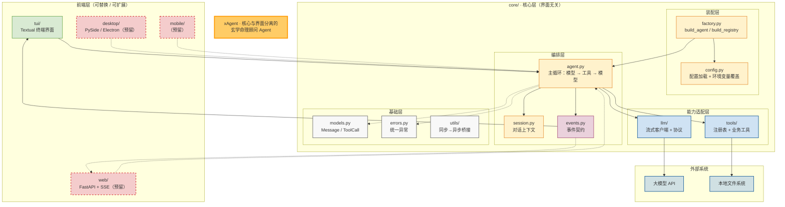
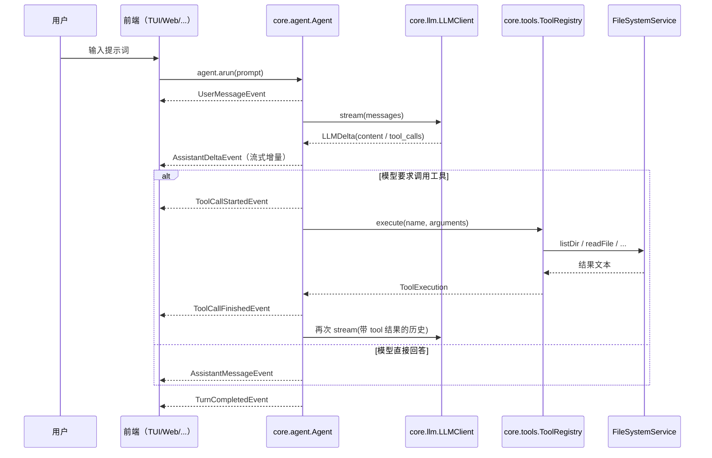

# xAgent 架构说明

## 1. 总体结构

## 2. 一次对话的完整时序

## 3. 关键设计决策

| 决策 | 原因 |
| --- | --- |
| core 用**事件流**输出，而非返回值 | 前端可实时渲染；同一套 core 适配 TUI / Web / Desktop |
| core 同步实现 + `iterate_in_thread` 提供异步接口 | 复用成熟的 `requests` 生态，同时不阻塞异步前端的事件循环 |
| 工具"业务逻辑"与"模型契约"分离（`service` / `toolset`） | 业务逻辑可独立测试；工具名与 schema 的变更不影响业务 |
| 工具失败返回**文本**而不是抛异常 | 模型能读懂错误并自行纠正参数重试 |
| 配置支持环境变量覆盖 | 多环境部署 / 密钥不入库 |
| 用测试守护分层约束 | 防止后续开发把框架依赖带回 core |

## 4. 目录职责对照

| 路径 | 职责 | 允许依赖 |
| --- | --- | --- |
| `core/models.py` `core/events.py` `core/errors.py` | 数据结构 | 仅标准库 |
| `core/config.py` | 配置读取 | 仅标准库 |
| `core/llm/*` | 模型接口适配 | `requests`、core 基础层 |
| `core/tools/fileops` `core/tools/systime` | 本地文件/目录、时间能力 | 标准库、core 基础层 |
| `core/tools/fetchweb` `core/tools/search` | 网页抓取、网络搜索 | `requests`/`trafilatura`、core 基础层 |
| `core/tools/runcli` | 本地命令行执行 | 标准库、core 基础层 |
| `core/tools/skills` `core/tools/context` | 技能加载/创建、归档召回 | 标准库、core 基础层 |
| `core/tools/mcp` | 外部 MCP Server 桥接 | `mcp`、core 基础层 |
| `core/session.py` `core/agent.py` | 业务编排 | core 内部各层 |
| `core/factory.py` | 依赖装配 | core 内部各层 |
| `tui/*` | 终端界面 | `textual`、`core`（只读消费） |
| `web/` `desktop/` `mobile/` | 未来前端 | 各自框架、`core`（只读消费） |

## 5. 扩展点

### 5.1 新增工具

在 `core/tools/<模块>/` 下新增 `service.py`（业务）+ `toolset.py`（schema 包装），
然后在 `core/factory.py::build_registry()` 注册。core 之外的代码零改动。

### 5.2 新增前端

新建同级目录 `web/`（或 `desktop/`、`mobile/`），规则只有三条：

1. 只能依赖 `core`，不能反向依赖；
2. 输入通过 `agent.arun(prompt)` 提交；
3. 展示通过消费 `core.events` 的事件完成。

### 5.3 更换模型厂商

实现 `core/llm/protocol.py::LLMClientProtocol`（`stream` / `astream` / `tool_schemas`），
在 `core/factory.py::build_client()` 中替换即可，Agent 与所有前端零改动。
